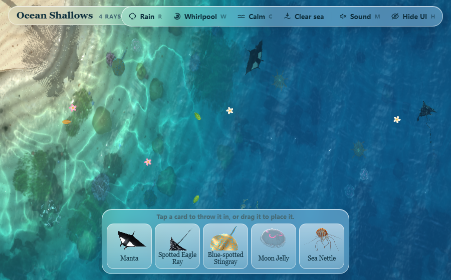

# 🌊 Ocean Shallows

> A single-file WebGL toy: a top-down slice of tropical shallows.
> Generated from scratch by **Claude Opus**, then iterated on (adaptive quality,
> rain streaks and rings, drag wakes, mobile audio unlock). Every mesh, texture
> and shader is produced in code, and the repository ships **no image or model
> assets at all**.
>
> **Credits:** the idea and the initial prompt come from
> [@vib3coded on X](https://x.com/vib3coded/status/2111170001403040187)
> (an Opus vs. Astra model comparison, 2026-10-16). This repo is a second pass
> on that prompt's output.

🔗 **Live demo:** <https://yg-sea.pages.dev/>



## What it is

A tropical sea seen from directly above. Sandbars, coral heads, seagrass,
starfish and shells are all computed, not drawn. The water surface is a wave
equation solved on the GPU every frame. Five creatures can be thrown into the
water from the dock at the bottom of the screen, and they swim, bank, startle
and settle on their own.

## Controls

| Input | Result |
|---|---|
| Click or tap the water | Drops a ring into the surface |
| Press and drag | A continuous wake follows the pointer |
| `R` | Rain: falling streaks plus rings spreading on the surface |
| `W` | Place a whirlpool; drag it to move it |
| `C` | Return the sea to calm |
| `M` | Toggle sound (on phones you have to tap it yourself) |
| `H` | Hide or show the interface |

The five cards are Manta, Spotted Eagle Ray, Blue-spotted Stingray, Moon Jelly
and Sea Nettle. Tap one to toss it in on an arc, or drag it and release where
you want it to land.

## How it works

- **Raw WebGL with three.js r128**, inlined into the HTML. No dependencies, no
  network requests, works offline.
- **GPU height field.** Ping-pong float textures run the wave equation each
  frame. When half-float render targets aren't available the target format
  drops a step automatically instead of failing.
- **Adaptive quality.** Frame time is measured continuously and used to scale
  render resolution, ripple-field resolution and the number of caustic layers.
  The budget targets 30 fps on phones and 60 fps on desktop.
- **Procedural terrain.** Four octaves of fbm noise are baked into a depth map,
  with the coastline jittered by layered sines so the beach never looks
  machine-cut.
- **Instanced creatures.** Rays are instanced two-sheet geometry: the wing bend
  happens in the vertex shader, so a shoal costs one draw call.
- **Mobile reality check.** Chinese Chromium forks (Quark, Baidu, UC and
  friends) frequently rasterise WebGL in software. Those user agents get a lower
  quality floor so the frame rate stays usable.

## Running it

Single file, no build step:

```
open index.html
```

Or serve it locally, which avoids some browsers' `file://` restrictions:

```bash
python -m http.server 8080
# then open http://127.0.0.1:8080
```

WebGL is required. If the GPU is disabled, the page shows an explicit error
message rather than a blank screen.

## Third-party

| Component | License | Notes |
|---|---|---|
| three.js r128 | MIT | Inlined; copyright notice preserved inside `index.html` |

See [`THIRD-PARTY-NOTICES.md`](./THIRD-PARTY-NOTICES.md) for the full text.

## Usage terms

This project is **not** released under an open-source license. The source is
public for reading and learning only.

- Allowed: reading, cloning, and running it locally to study the implementation
- Not allowed: commercial use, redistribution, or republishing it as your own
  work without written permission
- To ask for permission: open an issue

> This project was built by AI and iterated on. The copyright status of
> AI-generated output differs between jurisdictions: the United States requires
> a human author, while Chinese courts have tended to recognise AI-assisted
> work that involved substantial human direction. No open-source license is
> applied here, which makes the default **all rights reserved**.
